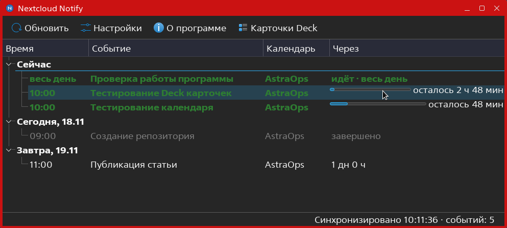
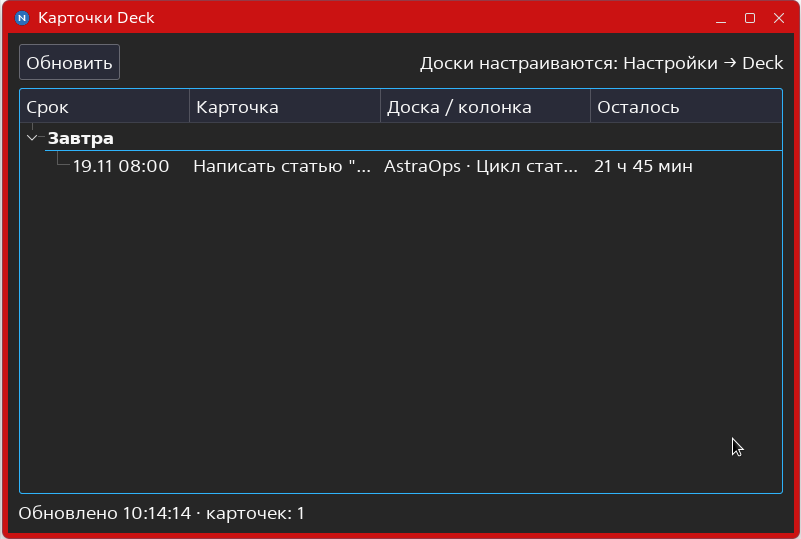

# nc-notify

Настольное приложение для Astra Linux (Fly) и других окружений на Qt5: напоминания
о событиях календаря Nextcloud и о карточках Deck. Работает в системном трее,
показывает ближайшие события и заранее уведомляет о них через штатный центр
уведомлений fly-notifications и собственное всплывающее окно.

## Возможности

- Календарь Nextcloud по CalDAV: ближайшие события, повторяющиеся события (RRULE),
  группы «Сейчас / Сегодня / Завтра / Позже», прогресс идущих событий и обратный отсчёт.
- Карточки Nextcloud Deck: выбор досок, сроки, группы «Просрочено / Сегодня / Завтра /
  На неделе / Позже / Без срока», переход к карточке в браузере.
- Уведомления: собственное окно и fly-notifications; режимы «оба / только fly /
  только окно / выключены»; звуковой сигнал; произвольный список порогов
  «за N минут» (например 1440, 60, 15, 5); кнопка «Отложить 5 минут»;
  защита от повторных срабатываний после синхронизации и перезапуска.
- Несколько календарей, автоматическая синхронизация по таймеру, пункт
  «Обновить сейчас» в меню трея.
- Пароль приложения хранится в системной связке ключей (gnome-keyring),
  в конфигурационном файле паролей нет.
- Самоподписанный сертификат сервера: доверие по отпечатку SHA-256 (pinning)
  с подтверждением при первом подключении.
- Автозапуск при входе в систему, запуск свёрнутым в трей, защита от второй копии.
- Сквозная авторизация Kerberos/SPNEGO для доменных сред (экспериментально).

## Требования

- Astra Linux 1.8 (Debian 12) с окружением Fly, либо другой дистрибутив с Qt5
  и службой уведомлений org.freedesktop.Notifications.
- Nextcloud с приложениями Calendar и Deck.
- Связка ключей (gnome-keyring или совместимая служба Secret Service) для
  хранения пароля.
- Зависимости устанавливаются автоматически вместе с пакетом.

## Установка из пакета

Скачайте `.deb` и файл контрольной суммы со страницы релизов, затем:

    sha256sum -c nc-notify_1.0.1_amd64.deb.sha256
    sudo apt install ./nc-notify_1.0.1_amd64.deb

Запуск: меню приложений «Nextcloud Notify» или команда `nc-notify`.

Удаление:

    sudo apt remove nc-notify

## Первоначальная настройка

1. Создайте пароль приложения в Nextcloud: аватар → Настройки → Безопасность →
   Устройства и сессии → имя приложения `nc-notify` → Создать новый пароль приложения.
   Основной пароль аккаунта использовать не нужно.
2. Откройте настройки приложения, вкладка «Аккаунт»: адрес сервера
   (например `https://cloud.example.com`), логин, пароль приложения.
   Нажмите «Найти календари» и отметьте нужные. При самоподписанном сертификате
   подтвердите отпечаток SHA-256.
3. Вкладка «Deck»: включите карточки, нажмите «Найти доски», отметьте доски.
4. Вкладка «Уведомления»: режим, звук, пороги «за сколько минут».
5. Вкладка «Общие»: автозапуск и запуск свёрнутым в трей.

Окно календаря открывается кнопкой на панели или значком в трее, окно карточек —
кнопкой «Карточки Deck». Закрытие окна прячет его в трей; полный выход — пункт
«Закрыть» в меню значка.

## Сборка из исходников

Установите зависимости сборки:

    sudo apt install build-essential qtbase5-dev qtbase5-dev-tools qt5-qmake \
        libqt5svg5-dev libical-dev qtkeychain-qt5-dev libsecret-1-dev \
        libcanberra-dev libcurl4-openssl-dev pkg-config python3 dpkg-dev

Соберите и запустите:

    git clone <адрес репозитория> nc-notify
    cd nc-notify
    mkdir -p build && cd build
    qmake -qt=5 ../nc-notify.pro
    make -j$(nproc)
    ./nc-notify

Сборка собственного .deb-пакета:

    bash packaging/build-deb.sh

Готовый пакет и контрольная сумма появятся в каталоге `dist/`.
Перед сборкой укажите свой контакт в файле `packaging/maintainer`.

## Ключи запуска

    nc-notify --version      версия программы
    nc-notify --minimized    запуск только в трей
    nc-notify --verbose      подробный вывод в терминал
    nc-notify --curl-info    диагностика GSS-API/SPNEGO для Kerberos

## Хранение данных

- Настройки: `~/.config/nc-notify/nc-notify.conf` (паролей не содержит).
- Пароль приложения: системная связка ключей, служба `nc-notify`,
  ключ `caldavPassword`.
- Автозапуск: `~/.config/autostart/nc-notify.desktop`.
- Отпечаток сертификата сервера сохраняется в настройках.

Приложение не отправляет данные третьим лицам: обращения идут только к вашему
серверу Nextcloud.

## Известные ограничения

- Сквозная авторизация Kerberos не протестирована в доменной среде.
- Цельнодневные события отображаются в списке, но не уведомляются.
- Переопределения THISANDFUTURE в повторяющихся событиях не разворачиваются.
- В режиме Kerberos карточки Deck пока работают только по паролю приложения.

## Структура проекта

    src/            исходники C++ (Qt5)
    icons/          иконка приложения
    tools/          генерация иконок
    packaging/      сборка .deb, desktop-файл, man-страница, changelog
    docs/           снимки экрана

## Авторы

Автор программы: Qwen (AI-ассистент, Alibaba Group).
Идея, постановка задачи, тестирование и сопровождение: Andrew.

## Лицензия

MIT, см. файл LICENSE.
